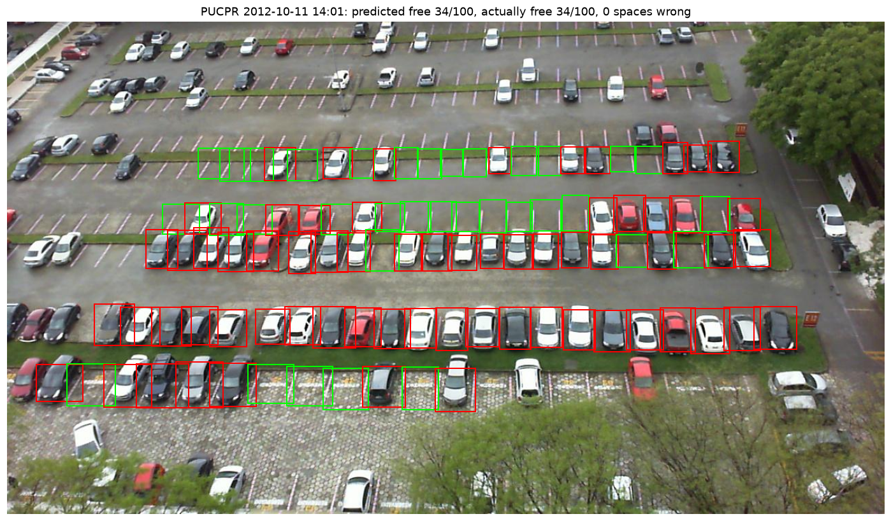
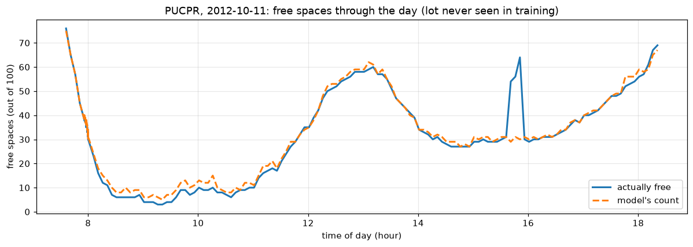

# ParkVision

**Detecting empty and occupied parking spaces from a single camera image, and testing whether it works on a parking lot the model has never seen.**


*The model running on PUCPR, a lot it never saw during training. Green = predicted empty, red = predicted occupied. (This photo was picked by a fixed rule, "the photo closest to 2 PM on the busiest day," not because it scored well. The full-day chart below shows the typical error.)*

## The problem

Drivers waste time circling full lots looking for a space. Many lots already have security cameras pointed at them.
If a camera image can tell us which spaces are free, a lot can show live availability without installing a sensor in every space.

## Results

| | Accuracy |
|---|---|
| Validation: same lot as training (UFPR), held-out days | **99.4%** |
| **Test: a different lot never seen in training (PUCPR)** | **94.1%** |

Over a full day at the unseen lot (185 photos), the model's count of free spaces was off by **1.6 spaces on average** (out of 100).



The one big spike near 4 PM (the true count jumps by ~30 spaces for a single photo, then drops back) is almost certainly
a **labeling error in the dataset**: a lot doesn't empty and refill 30 spaces in 5 minutes. The model's count stays steady there.

## The key finding: data leakage in the default split

The dataset comes pre-split into train/valid/test folders by Roboflow. In [notebook 01](01_explore_data.ipynb) I found that:

1. **Every camera appears in every split.** The test set is the same parking lots as training.
2. **The cameras took a photo every 5 minutes**, so test photos have near-identical twins in the training set.

A model evaluated on that split is being tested on images very similar to ones it already learned from, so its score is artificially high.
This project's model scores **99.4%** on its own lot but **94.1%** on a new one. The default split would have hidden that 5-point drop.

**What I did instead:**
- **Test on a different parking lot:** train on UFPR (cameras UFPR04 + UFPR05), test only on PUCPR.
- **Validate on different days:** the last 20% of days for each training camera are held out, so validation photos aren't 5-minute neighbors of training photos.

The filenames don't say which camera took each photo, but each camera always sees a fixed number of labeled spaces
(PUCPR = 100, UFPR04 = 28, UFPR05 = 40), so that count identifies the camera.

## How it works

| Notebook | What it does |
|---|---|
| [01_explore_data](01_explore_data.ipynb) | Explores the annotations, finds the leakage problem and data issues |
| [02_make_patches](02_make_patches.ipynb) | Crops every labeled space into a 64×64 image (168,000 patches from 3,000 photos) |
| [03_train_small_cnn](03_train_small_cnn.ipynb) | Trains a small CNN on UFPR, then tests it once on PUCPR |
| [04_full_lot_demo](04_full_lot_demo.ipynb) | Runs the model on whole photos and tracks free spaces over a day |

**Model:** a small convolutional neural network built from scratch (3 conv blocks → global average pooling → 2 outputs, about 94,000 parameters).
It's trained with brightness and left/right-flip augmentation, since the test lot was filmed in a different season with different lighting.
Training takes about a minute on an RTX 5070. The model and cropping code live in [`model.py`](model.py) so every notebook uses identical preprocessing.

## Limitations

- **The space locations must already be known.** The model classifies spaces; it doesn't find them. A new lot needs its spaces marked once.
- **Overlapping boxes.** The original labels are rotated rectangles; this version of the dataset converts them to straight boxes, which often
  include part of a neighboring car (about half of UFPR04 boxes are more than 25% covered by a neighbor). Some "mistakes" are really this.
- **Label noise.** Looking at the misclassified patches, some spaces labeled "empty" clearly contain a car.
- **Only two parking lots.** 94% on one unseen lot is encouraging, not proof it works everywhere.

## Next steps

- Compare against a pretrained model (ResNet18) to see if it shrinks the 5-point gap between lots
- Put the web demo online (Hugging Face Spaces) so anyone can try it in a browser
- Test on photos of a real NC State parking lot

## Run it yourself

```bash
git clone https://github.com/abhasuru/parkvision.git
cd parkvision
python -m venv .venv
.venv\Scripts\python -m pip install torch torchvision --index-url https://download.pytorch.org/whl/cu130   # GPU (NVIDIA)
.venv\Scripts\python -m pip install -r requirements.txt
```

Download the dataset from [Roboflow (PKLot, "raw" version, COCO format)](https://universe.roboflow.com/brad-dwyer/pklot-1tros/dataset/1) and unzip it
into the project folder (you should get `train/`, `valid/` and `test/`). Then run the notebooks in order.
The trained model (`small_cnn_best.pt`) is included, so you can skip straight to notebook 04.

## Web demo

[`app.py`](app.py) is a small web app: pick an example photo (or upload a new photo from one of the three cameras) and it marks every space and counts the free ones.

```bash
.venv\Scripts\python app.py
```

Then open the link it prints (usually http://127.0.0.1:7860). The space positions for each camera are stored in [`layouts.json`](layouts.json), since each camera always looks at the same spaces.

## Data and credit

PKLot dataset, licensed CC BY 4.0:

> Almeida, P., Oliveira, L. S., Silva Jr, E., Britto Jr, A., Koerich, A. *PKLot – A robust dataset for parking lot classification.* Expert Systems with Applications, 42(11):4937–4949, 2015.

Code was written with help from an AI assistant (Claude). The experiment design, evaluation choices and findings are explained in the notebooks.
